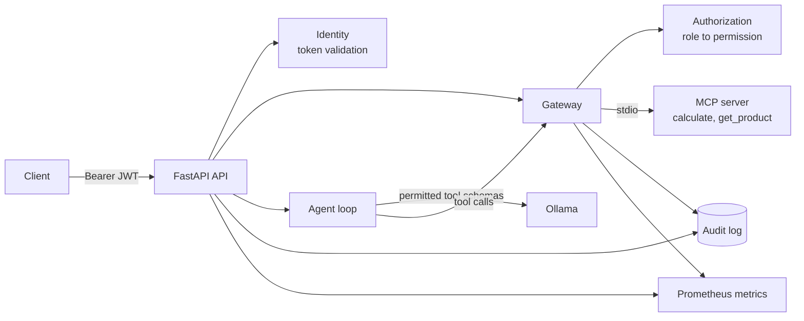

# Secure Agent Integrations

An AI agent that calls tools through **MCP**, routes every call through an
**authorizing gateway**, and identifies every caller with **signed JWT
identities**. Every request is recorded in a structured **audit log** and
exposed through **Prometheus metrics**.

The agent runs locally on [Ollama](https://ollama.com), so prompts and tool
data stay on your machine.

## Features

| Area | What you get |
|---|---|
| **MCP tools** | Tools served by an MCP server that runs as a private subprocess over stdio, with no network listener |
| **Gateway routing** | Tool discovery and execution go through one gateway that filters schemas by role and checks permission on every call |
| **Identity** | JWT bearer tokens with issuer, audience, expiry, and unique ID checks; role-based permissions |
| **Authenticated access** | Every endpoint except `/health` and the documentation pages requires a valid token |
| **Audit logging** | Rotating JSON-lines log recording who did what, the outcome, and why a request failed |
| **Metrics** | Prometheus counters and histograms for HTTP requests, tool calls, and authentication failures |

## Architecture



### Request flow

1. FastAPI validates the JWT and records the caller's identity.
2. The gateway discovers tools from the MCP server.
3. Only the tool schemas the caller's role may use are passed to Ollama.
4. Ollama requests a tool call.
5. The gateway revalidates the token and checks the role's permission.
6. The MCP server executes the tool.
7. The result returns to Ollama, which writes the final answer.
8. The audit log and metrics record the outcome of every step.

## Technology

- Python 3.12
- FastAPI and Uvicorn
- MCP Python SDK
- Ollama
- PyJWT
- prometheus-client

## Quick start

### 1. Install

From the project root.

**Windows (Git Bash):**

```bash
python -m venv .venv
source .venv/Scripts/activate
```

**macOS / Linux:**

```bash
python3 -m venv .venv
source .venv/bin/activate
```

Then, on any platform:

```bash
python -m pip install -r requirements.txt
python -m pip install -e .
python scripts/local_identity.py init
```

`init` creates `.env` with a generated JWT signing secret. It never
overwrites an existing `.env`.

### 2. Start Ollama

Install [Ollama](https://ollama.com), then download the model:

```bash
ollama pull qwen2.5:7b-instruct
```

Ollama normally runs in the background. If it does not, start it in a
separate terminal:

```bash
ollama serve
```

### 3. Run the application

```bash
python -m secure_agent
```

The API listens on `http://127.0.0.1:8000`. Interactive documentation is at
`http://127.0.0.1:8000/docs`.

### 4. Get a token

In a second terminal, with the virtual environment active:

```bash
python scripts/local_identity.py token --subject arshad --role operator
```

Tokens expire after 30 minutes by default.

### 5. Ask the agent

**From the API documentation:** open `/docs`, click **Authorize**, paste the
token (without the word `Bearer`), and call `POST /agent`.

**From the command line:**

```bash
TOKEN=$(python scripts/local_identity.py token --subject arshad --role operator)

curl -s -X POST http://127.0.0.1:8000/agent \
  -H "Authorization: Bearer $TOKEN" \
  -H "Content-Type: application/json" \
  -d '{"prompt": "Find the price of product P100 and calculate the total for 3 units."}'
```

Example response:

```json
{
  "answer": "The price of product P100 (Laptop) is 65000 INR. The total cost for 3 units would be 195000 INR.",
  "tools_used": ["get_product", "calculate"],
  "request_id": "2d408a12274a4bfbaa036f9009afc07b"
}
```

The `request_id` is also returned in the `X-Request-ID` response header and
appears in every audit record for that request.

## Identity and roles

Tokens are HS256-signed JWTs with these claims:

| Claim | Meaning |
|---|---|
| `sub` | Identity of the caller (1 to 100 characters) |
| `role` | `reader`, `operator`, or `admin` |
| `iss` / `aud` | `secure-agent-local` / `secure-agent-api` |
| `iat` / `exp` | Issued-at and expiry times |
| `jti` | Unique token ID |

All claims are required. The signing secret must be at least 32 characters.

| Role | Product lookup | Calculator | Metrics |
|---|:---:|:---:|:---:|
| `reader` | Yes | No | No |
| `operator` | Yes | Yes | No |
| `admin` | Yes | Yes | Yes |

```bash
python scripts/local_identity.py token --subject alice --role reader
python scripts/local_identity.py token --subject carol --role admin
```

Issuing tokens is a trusted operator action. Anyone with access to the
signing secret can issue tokens, so keep `.env` private. It is excluded from
version control.

## API reference

| Endpoint | Auth | Purpose |
|---|---|---|
| `GET /health` | None | API liveness |
| `GET /docs` | None | Interactive API documentation |
| `POST /agent` | Any role | Ask the agent a question |
| `GET /tools` | Any role | List the tool schemas your role may use |
| `POST /tools/{name}` | Role with the tool's permission | Execute a tool through the gateway |
| `GET /metrics` | `admin` | Prometheus metrics |

Example body for `POST /tools/calculate`:

```json
{
  "arguments": {
    "operation": "multiply",
    "a": 12,
    "b": 12
  }
}
```

### Tools

| Tool | Permission | Description |
|---|---|---|
| `get_product` | `tools:read` | Look up a product by ID. Demo data: P100 Laptop (65,000 INR), P200 Monitor (15,000 INR), P300 Keyboard (2,000 INR) |
| `calculate` | `tools:calculate` | `add`, `subtract`, `multiply`, or `divide` two finite numbers |

Tool validation and execution errors are returned as `"isError": true` in the
tool response, so check that field in addition to the HTTP status.

### Status codes

| Code | Meaning |
|---|---|
| 200 | Request handled (for tools, check `isError`) |
| 401 | Token missing, invalid, or expired |
| 403 | The role lacks the required permission |
| 404 | Unknown tool |
| 422 | Request body failed validation |
| 502 | Ollama is unreachable or returned an invalid response |
| 504 | Ollama exceeded its timeout |

## Security design

- **Authentication on every route.** Only `/health` and the documentation
  pages are public.
- **Defense in depth.** The model is only shown tools its role may use, and
  the gateway checks permission again on every call, so a misbehaving model
  cannot run a tool outside the caller's role.
- **Fail closed.** A tool without an entry in the permission map is hidden
  from discovery and rejected on call.
- **Generic errors for callers.** A rejected token always produces the same
  401 response. The specific reason goes only to the audit log and metrics.
- **Private tool transport.** The MCP server runs as a subprocess of the API
  and communicates over stdio.
- **Loopback binding.** The API listens on `127.0.0.1` only.
- **Strict input handling.** Request bodies reject unknown fields, and
  prompts are limited to 8,000 characters.
- **No sensitive content in telemetry.** Tokens, prompts, tool arguments, and
  tool results are never written to the audit log.

## Observability

### Audit log

Events are written to `logs/audit.jsonl` as one JSON object per line. Logs
rotate at 2 MB and keep three backups.

| Event | Written when | Key fields |
|---|---|---|
| `http_request` | Every request | `route`, `status`, `duration_ms`, `subject`, `role`, `reason`, `cause` |
| `auth_failure` | A token is missing or rejected | `reason`, `route`, `client` |
| `tool_call` | The gateway handles a tool call | `subject`, `tool`, `outcome`, `reason`, `duration_ms` |
| `request_error` | An unhandled exception occurs | `error_type` |

Every record has a `timestamp`, an `event` name, and a `request_id`.
`subject` and `role` are `null` when the request was not authenticated.

**Reasons for 401** (`auth_failure.reason`): `missing_token`,
`malformed_token`, `invalid_signature`, `invalid_algorithm`, `token_expired`,
`invalid_audience`, `invalid_issuer`, `missing_claim`, `invalid_subject`,
`invalid_role`.

**Reasons for 403:** `missing_permission:<permission>`, for example
`missing_permission:tools:calculate`.

**Other failures:** `reason` holds the error message returned to the caller,
and `cause` holds the exception type behind it, such as `ConnectError` or
`ReadTimeout` when Ollama is unreachable or slow.

Example trace for one request:

```json
{"event": "tool_call", "request_id": "2d408a12...", "subject": "arshad", "tool": "get_product", "outcome": "success", "reason": null, "duration_ms": 24.72}
{"event": "tool_call", "request_id": "2d408a12...", "subject": "arshad", "tool": "calculate", "outcome": "success", "reason": null, "duration_ms": 3.66}
{"event": "http_request", "request_id": "2d408a12...", "method": "POST", "route": "/agent", "status": 200, "subject": "arshad", "role": "operator", "reason": null, "cause": null}
```

Find everything that happened in one request:

```bash
grep <request_id> logs/audit.jsonl
```

### Metrics

`GET /metrics` returns Prometheus text format and requires an `admin` token.

| Metric | Labels | Description |
|---|---|---|
| `agent_http_requests_total` | `method`, `route`, `status` | HTTP requests |
| `agent_http_duration_seconds` | `route` | HTTP request duration |
| `agent_tool_calls_total` | `tool`, `outcome` | Tool calls (`success`, `error`, `denied`) |
| `agent_tool_duration_seconds` | `tool` | Tool execution duration |
| `agent_auth_failures_total` | `reason` | Rejected tokens by reason |

Route and tool labels use fixed values, so unknown paths and tool names do
not create new metric series. Metrics live in process memory, so run a single
API worker.

Example Prometheus scrape configuration:

```yaml
scrape_configs:
  - job_name: secure-agent
    metrics_path: /metrics
    authorization:
      type: Bearer
      credentials: <admin token>
    static_configs:
      - targets: ["127.0.0.1:8000"]
```

Tokens expire, so for long-running scrapes issue an admin token with a longer
`JWT_EXPIRY_MINUTES` (up to 1440).

## Configuration

Settings load from `.env` in the project root.

| Setting | Default | Purpose |
|---|---|---|
| `JWT_SECRET` | generated by `init` | Signing secret (at least 32 characters) |
| `JWT_EXPIRY_MINUTES` | `30` | Token lifetime (1 to 1440) |
| `OLLAMA_URL` | `http://localhost:11434` | Ollama address |
| `OLLAMA_MODEL` | `qwen2.5:7b-instruct` | Installed tool-capable model |
| `MAX_AGENT_STEPS` | `8` | Maximum model rounds per request (1 to 20) |
| `OLLAMA_TIMEOUT_SECONDS` | `180` | Timeout for each Ollama request |
| `MCP_TIMEOUT_SECONDS` | `20` | Timeout for each MCP request |

## Adding a tool

1. Write the function in `src/secure_agent/mcp/tools/`. Use type hints and a
   docstring, because they become the tool's schema and description.
2. Register it in `src/secure_agent/mcp/server.py` with `server.tool()(...)`.
3. Map it to a permission in `TOOL_PERMISSIONS` in
   `src/secure_agent/authz/policies.py`.
4. Grant that permission to the right roles in `ROLE_PERMISSIONS`.

## Project structure

```
src/secure_agent/
  __main__.py            Application entry point
  api.py                 HTTP endpoints, authentication, request auditing
  agent.py               Ollama conversation and tool-calling loop
  config.py              Environment settings and paths
  identity/tokens.py     JWT issuing and validation
  authz/policies.py      Roles, permissions, and tool mapping
  gateway/router.py      MCP connection and authorized tool routing
  mcp/server.py          MCP server and tool registration
  mcp/tools/             calculator and product tools
  observability/
    logging.py           Rotating JSON audit log
    metrics.py           Prometheus metrics
scripts/local_identity.py   Initialization and token CLI
tests/                      Automated test suite
```

## Testing

```bash
python -m pip install -e ".[dev]"
python -m pytest
```

The suite needs no Ollama installation. It starts a fake Ollama server to
drive the agent loop and covers:

- every authentication failure mode
- role permissions for discovery, execution, and metrics
- gateway enforcement against a model that ignores its tool list
- the agent loop, including step limits, malformed tool calls, and Ollama
  being unreachable or slow
- audit log content, including that no secrets or request content are logged
- metric counts and label behavior

Tests write audit records to a temporary directory, so they never touch
`logs/`.

## Troubleshooting

| Symptom | What to check |
|---|---|
| `401` | Token missing, invalid, or expired. The `auth_failure` event in `logs/audit.jsonl` gives the exact reason. Paste the token into **Authorize** without the word `Bearer`. |
| `403` | The role lacks permission. The `reason` field names the missing permission. |
| `502` | Make sure Ollama is running (`curl http://localhost:11434`) and the model is installed (`ollama list`). The `reason` and `cause` fields of the `http_request` event show what failed. |
| `504` | Ollama timed out. The first request after startup can be slow while the model loads, so retry it or raise `OLLAMA_TIMEOUT_SECONDS`. |
| `ModuleNotFoundError` | Activate the virtual environment and run `python -m pip install -e .`. |
| `JWT_SECRET is missing or invalid` | Run `python scripts/local_identity.py init`. If `.env` already exists, edit its `JWT_SECRET` to a value of at least 32 characters. |
| Port 8000 already in use | Another copy of the app is running. Stop it, or find the process with `netstat -ano \| grep :8000`. |
